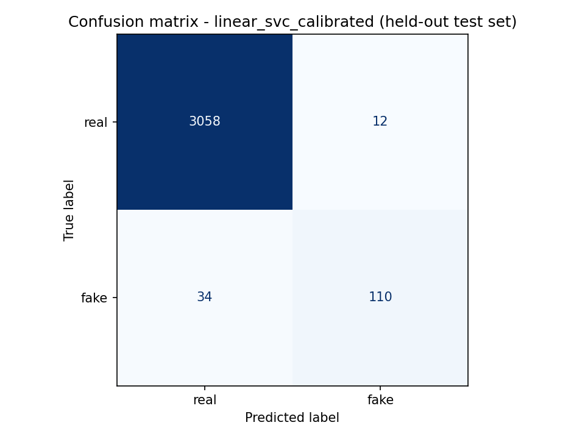

# Fake Job Posting Detector

A machine-learning project that flags fraudulent job postings. A posting goes in
(title, company profile, description, requirements, benefits), a trained model
scores how likely it is to be a scam.

Milestone 1 (this state): data preparation, baseline model training, and honest
evaluation. Next milestone: an inference API and a small web UI where a posting
can be pasted and scored.

**A project by Sandeep Sagar.**

## Why

Fake job listings are a real problem for job seekers: they harvest personal
details, push "advance fee" scams, or impersonate real companies. This project
builds a detector from a public research dataset and reports what the model
actually achieves, with its limits stated plainly.

## Dataset

**Employment Scam Aegean Dataset (EMSCAD)**, published by the Laboratory of
Information & Communication Systems Security, University of the Aegean
(van de Ven, Shiaeles et al.). 17,880 real-world job ads collected from
employment sites in 2012-2014, hand-annotated as real or fraudulent
(866 fraudulent, 4.84%). Released publicly for research purposes. The raw CSV
is not committed to this repo; see `data/README.md` for how to get it.

## Evaluation protocol

The numbers below follow a strict protocol, because the easy mistakes in this
kind of project all flatter the scores:

1. **Deduplicate before splitting.** The raw data contains 1,814 exact
   duplicate postings plus 317 more that differ only in case/punctuation.
   Left in, copies of the same ad can land on both sides of a random split and
   inflate scores. After dedup: 15,749 postings.
2. **One stratified 80/20 split** (12,599 train / 3,150 test, fixed seed),
   then the test set is locked. The dataset is only ~4.5% fraudulent, so plain
   accuracy is meaningless - a model calling everything "real" already scores
   ~95% and detects nothing. All metrics are for the **fraud class**
   (precision, recall, F1) plus ROC-AUC.
   **Disclosure:** an earlier iteration of this project inspected the test set
   during model selection; the protocol above is the correction. These numbers
   are therefore a *corrected exploratory evaluation*, not a pristine
   untouched-test measurement - a future refit on a re-drawn split (see
   Roadmap) is needed for that.
3. **Model selection uses the training set only**: 5-fold stratified
   cross-validation, ranked by mean fraud-class F1. The test set plays no part
   in choosing the model.
4. **Near-duplicate overlap is measured, not assumed away.** Deduplication
   removes identical postings, but the dataset also contains *reworded*
   reposts of the same ads. For every test posting we compute the maximum
   TF-IDF cosine similarity to any training posting. **1,273 of 3,150 test
   postings (40%) have a training near-twin** (similarity >= 0.8). Results are
   therefore reported twice: on the full test set, and on the restricted
   subset with no near-twins - the honest "unseen data" number.
5. **One-shot final evaluation.** The selected model is refit on the full
   training set and evaluated exactly once on the locked test set.

## Model selection (5-fold CV on training data only)

| Model | Precision (fraud) | Recall (fraud) | F1 (fraud) | ROC-AUC |
| --- | --- | --- | --- | --- |
| Dummy (always "real") | 0.000 | 0.000 | 0.000 | 0.500 |
| Multinomial Naive Bayes | 0.794 | 0.523 | 0.629 | 0.963 |
| Logistic regression | 0.783 | 0.800 | 0.791 | 0.978 |
| **Linear SVM (calibrated) - selected** | **0.923** | **0.758** | **0.832** | **0.981** |

Means over 5 folds; full table with standard deviations in
`models/metrics.json`. Features: TF-IDF (unigrams + bigrams) over the posting's
free-text fields.

## Final results (locked test set, evaluated once)

| Test set | Precision (fraud) | Recall (fraud) | F1 (fraud) | ROC-AUC |
| --- | --- | --- | --- | --- |
| Full (3,150 postings, 142 fraudulent) | 0.933 | 0.789 | 0.855 | 0.988 |
| Restricted - no training near-twins (1,877 postings, 87 fraudulent) | 0.919 | 0.655 | 0.765 | 0.974 |



On the full test set the model catches 112 of 142 fraudulent postings with 8
false alarms on 3,008 real ones. The restricted row is the more informative
one: recall drops to 0.66, because 40% of the test set overlaps with training
and flatters the headline number. It is still only a *diagnostic* - filtering
lookalikes from one already-inspected split is not proof of performance on
genuinely unseen, current postings.


## What the score means - and what it does not

The model's output is a **statistical signal learned from this dataset, not a
verdict**. Keep in mind:

- The data is from 2012-2014 job boards. Scam wording evolves; performance on
  current postings will be lower than on this test set.
- "Fraudulent" labels come from one research team's manual annotation of one
  set of sites. The model learns that labeling, not ground truth.
- A high score means "this posting reads like postings that were labeled
  fraudulent", never "this employer is a criminal". A low score is not a
  guarantee of safety - on unseen-looking postings the model misses about a
  third of the fraudulent ones.
- Treat the output as one input to your own judgment, alongside direct checks:
  verify the company on its official site, never pay any fee to apply, never
  share bank/ID documents before a signed offer, and be wary of interviews
  conducted entirely over chat apps.

## Repo layout

```
data/README.md      dataset provenance and how to obtain it
src/prepare.py      loading, combined text field, dedup, stratified split
src/train.py        staged pipeline: split -> select (training-only CV) -> final
                    (one-shot test evaluation + near-twin analysis)
models/model.joblib selected pipeline (TF-IDF + calibrated linear SVM)
models/metrics.json full evaluation results
docs/               confusion matrix and ROC curve images
tests/              unit tests for the data preparation code
```

## Run it

```bash
pip install -r requirements.txt
# place the dataset CSV at data/fake_job_postings.csv (see data/README.md)
python src/train.py --csv data/fake_job_postings.csv          # full pipeline
python src/train.py --stage select --only logistic_regression # or stage by stage
python -m pytest tests/
```

## Roadmap

- **M2:** inference API + web UI - paste a posting, get a score with the
  uncertainty framing above, plus safe-verification tips.
- **Evaluation hardening:** group-aware splitting - cluster near-duplicate
  postings into groups and keep whole groups on one side of the split and
  within single CV folds - so generalization claims stop relying on the
  near-twin diagnostic. Until then, no strong claims about performance on
  unseen data.
