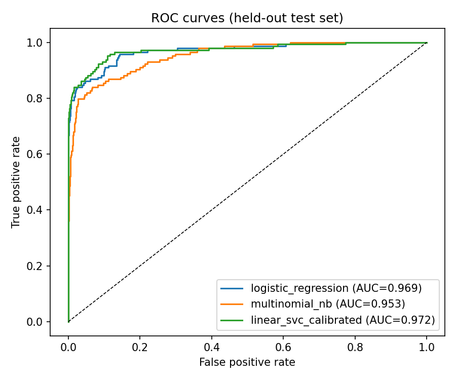

# Fake Job Posting Detector

A machine-learning project that flags fraudulent job postings. A posting goes in
(title, company profile, description, requirements, benefits), a trained model
scores how likely it is to be a scam.

Milestone 1 (this state): data preparation, baseline model training, and honest
evaluation on a held-out test set. Next milestone: an inference API and a small
web UI where a posting can be pasted and scored.

**A project by Sandeep Sagar.**

## Why

Fake job listings are a real problem for job seekers: they harvest personal
details, push "advance fee" scams, or impersonate real companies. This project
builds a detector from a public research dataset and reports what the model
actually achieves, with its limits stated plainly.

## Dataset

**Employment Scam Aegean Dataset (EMSCAD)**, published by the Laboratory of
Information & Communication Systems Security, University of the Aegean
(B. van de Ven, S. Shiaeles et al.). 17,880 real-world job ads collected from
employment sites in 2012-2014, hand-annotated as real or fraudulent
(866 fraudulent, 4.84%). Released publicly for research purposes. The raw CSV
is not committed to this repo; see `data/README.md` for how to get it.

## Approach

1. **Deduplicate before splitting.** The raw data contains 1,814 exact
   duplicate postings. Left in, copies of the same ad could land on both sides
   of a random split and inflate the scores. After dedup: 16,066 postings.
2. **Stratified 80/20 split** (12,852 train / 3,214 test, fixed seed). The
   dataset is only ~4.5% fraudulent, so plain accuracy is meaningless - a model
   that calls everything "real" already scores ~95% and detects nothing. All
   metrics below are for the **fraud class**: precision, recall, F1, plus
   ROC-AUC.
3. **Features:** TF-IDF over the posting's free-text fields (title, company
   profile, description, requirements, benefits), unigrams + bigrams.
4. **Models compared:** a majority-class dummy (the floor), multinomial Naive
   Bayes, logistic regression, and a calibrated linear SVM. The model with the
   best fraud-class F1 on the test set is selected and saved
   (`models/model.joblib`).

## Results (held-out test set, 3,214 postings, 144 fraudulent)

| Model | Precision (fraud) | Recall (fraud) | F1 (fraud) | ROC-AUC |
| --- | --- | --- | --- | --- |
| Dummy (always "real") | 0.000 | 0.000 | 0.000 | 0.500 |
| Multinomial Naive Bayes | 0.868 | 0.458 | 0.600 | 0.953 |
| Logistic regression | 0.776 | 0.792 | 0.784 | 0.969 |
| **Linear SVM (calibrated) - selected** | **0.902** | **0.764** | **0.827** | **0.972** |


On the test set the selected model catches 110 of 144 fraudulent postings and
raises 12 false alarms on 3,070 real ones. Full numbers, including the
confusion matrices for every model, are in `models/metrics.json`.



## What the score means - and what it does not

The model's output is a **statistical signal learned from this dataset, not a
verdict**. Keep in mind:

- The data is from 2012-2014 job boards. Scam wording evolves; performance on
  current postings will be lower than on this test set.
- "Fraudulent" labels come from one research team's manual annotation of one
  set of sites. The model learns that labeling, not ground truth.
- A high score means "this posting reads like postings that were labeled
  fraudulent", never "this employer is a criminal". A low score is not a
  guarantee of safety either - 34 of 144 fraudulent test postings were missed.
- Treat the output as one input to your own judgment, alongside direct checks:
  verify the company on its official site, never pay any fee to apply, never
  share bank/ID documents before a signed offer, and be wary of interviews
  conducted entirely over chat apps.

## Repo layout

```
data/README.md      dataset provenance and how to obtain it
src/prepare.py      loading, combined text field, dedup, stratified split
src/train.py        training + evaluation, writes model, metrics, plots
models/model.joblib selected pipeline (TF-IDF + calibrated linear SVM)
models/metrics.json full evaluation results
docs/               confusion matrix and ROC curve images
tests/              unit tests for the data preparation code
```

## Run it

```bash
pip install -r requirements.txt
# place the dataset CSV at data/fake_job_postings.csv (see data/README.md)
python src/train.py --csv data/fake_job_postings.csv
python -m pytest tests/
```

## Roadmap

- **M2:** inference API + web UI - paste a posting, get a score with the
  uncertainty framing above, plus safe-verification tips.
